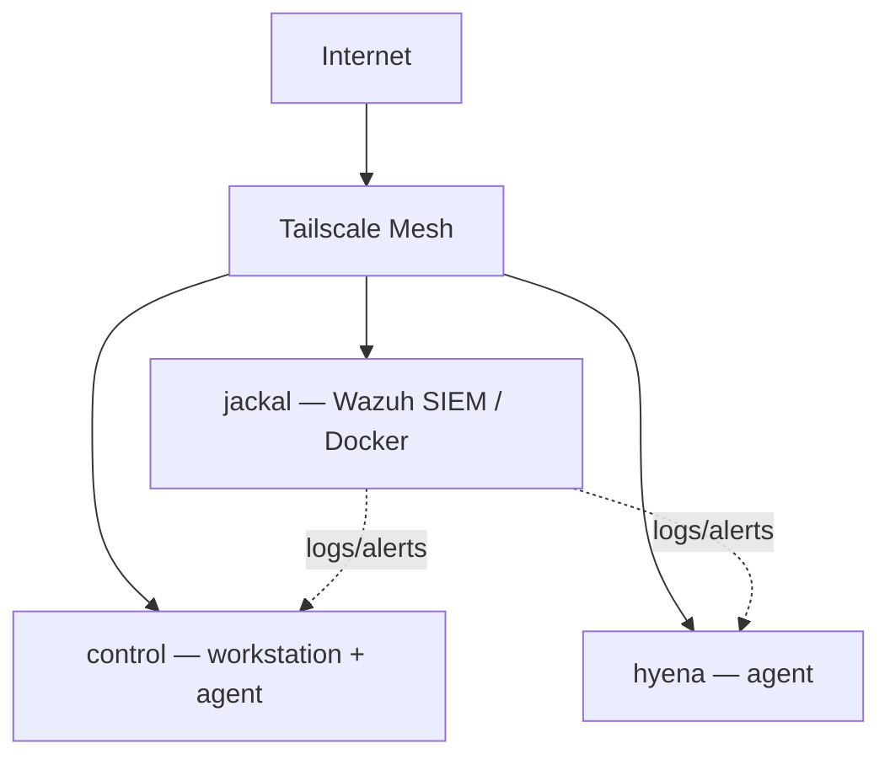

# Homelab

> _One-line description of the lab and its purpose._

---

## Overview
_3–5 sentences: what the lab is, what it runs on, and what you use it for._

## Hardware
| Host | Role | CPU | RAM | Storage | OS |
|------|------|-----|-----|---------|----|
| `jackal` | Primary server — Docker services & SIEM manager | _ _ | _ _ | _ _ | _ _ |
| `control` | Workstation / daily driver | _ _ | _ _ | _ _ | _ _ |
| `hyena` | _role_ | _ _ | _ _ | _ _ | _ _ |

## Network
- **Topology:** _ _
- **Remote access:** Tailscale mesh — _ _
- **DNS / addressing:** _ _
- **Segmentation:** _ _

## Services
### Wazuh SIEM
- **Purpose:** Centralized security monitoring
- **Host:** `jackal`
- **Deployment:** Docker (manager / indexer / dashboard)
- **Agents:** _control / hyena_
- **Notes:** _ _

## Security Monitoring
- **Stack:** Wazuh (manager + indexer + dashboard) + agents
- **Collected:** _ _
- **Alerting:** _ _
- **Detections practiced:** _ _

## Projects
- [ThinkPad T470 BIOS Supervisor Password Removal](thinkpad-bios-unlock/README.md)

## Setup / Reproducing This Lab
1. Provision hosts — _ _
2. Base OS install & hardening — _ _
3. Tailscale mesh + remote SSH — _ _
4. Deploy Wazuh (Docker) on `jackal` — _ _
5. Enroll agents — _ _
6. Backups — _ _

## Backups & Recovery
- **What's backed up:** _ _
- **Where / how often:** _ _
- **Restore:** _ _

## Lessons Learned / Roadmap
- _ _
- **Next:** coreboot on the T470, more detection exercises, Security+

## Architecture Diagram

